# ARQUITECTURA DEL SISTEMA WEB INTEGRAL DE CONTROL DE BIENES Y EXISTENCIAS
**Versión 2.7.0 | Google Apps Script + Google Sheets + Google Drive**

---

## 1. Visión General de la Arquitectura

El **Sistema Web Integral de Control de Bienes y Existencias** es una solución corporativa basada en el patrón arquitectónico **Serverless Single-Page Application (SPA)**, ejecutada en la infraestructura Cloud de **Google Apps Script (V8 Runtime)** y respaldada por tres servicios nativos de Google Workspace:
1. **Google Sheets** como motor relacional de base de datos persistente (10 hojas institucionales).
2. **Google Drive** como repositorio privado seguro para el almacenamiento y compresión de fotografías de activos patrimoniales (carpeta `SISTEMA_BIENES_FOTOS`).
3. **Gmail / MailApp & ScriptApp Triggers** para el monitoreo automatizado y despacho programado diario de alertas de stock crítico por correo electrónico.

```mermaid
graph TD
    subgraph Frontend ["Capa Cliente (SPA Responsive)"]
        UI[HTML5 + CSS3 Custom + Bootstrap 5.3.3]
        ROUTER[Controlador SPA & Enrutador JS - app_js.html]
        MEJORAS[Módulo Mejoras v2.7 - mejoras_js.html]
        ZXING[ZXing JS + jsQR - Escáner Cámara / Fotos]
        CHARTS[Chart.js - Métricas y KPIs Interactivos]
        SHEETJS[SheetJS XLSX - Parser Excel / CSV]
        JSPDF[jsPDF + AutoTable - Generador PDF & Actas]
        QRCODE[QRCode.js - Renderizador de Etiquetas QR]
    end

    subgraph Transport ["Capa de Comunicación RPC"]
        GAS_BRIDGE[google.script.run / Asynchronous RPC Promise Wrapper]
    end

    subgraph Backend ["Capa de Negocio (Google Apps Script - V8)"]
        ROUTER_BE[Code.gs - doGet / Dispatcher / LockService / Helpers]
        AUTH[Login.gs - Token Cache & Protección Fuerza Bruta]
        USERS_SVC[Usuarios.gs - Control RBAC y Política Contraseñas]
        BIENES_SVC[Bienes.gs - BLD / BCA Core & Validaciones]
        FOTOS_SVC[Fotos.gs - Gestor de Imágenes en Google Drive]
        CUST_SVC[Custodios.gs - Asignaciones y Actualización en Cascada]
        STOCK_SVC[Existencias.gs - Stock Almacén y Umbrales Mínimos]
        KARDEX_SVC[Movimientos.gs - Saldo Atómico con LockService]
        AUDIT_SVC[Constatacion.gs - Auditoría Física Móvil / Ajustes]
        RONDAS_SVC[Rondas.gs - Constatación por Rondas y Actas]
        ALERTA_SVC[Alertas.gs - Triggers Diarios y Notificaciones Mail]
        MASS_SVC[Importacion.gs - Validador Lotes Masivos Excel/CSV]
        REP_SVC[Reportes.gs - Agregador KPIs y Depreciación en Línea Recta]
        SEC_SVC[Auditoria.gs - Bitácora Trazabilidad Inmutable]
        SETUP_DB[SetupDB.gs - Inicializador / Reparador de Base de Datos]
    end

    subgraph Persistence ["Capa de Almacenamiento & Servicios Google"]
        subgraph SheetsDB ["Google Sheets DB (10 Hojas)"]
            S_USERS[(USUARIOS)]
            S_ASSETS[(BIENES_MUEBLES_INMUEBLES)]
            S_CUST[(CUSTODIOS)]
            S_STOCK[(EXISTENCIAS)]
            S_KARDEX[(MOVIMIENTOS_EXISTENCIAS)]
            S_AUD_B[(CONSTACION_BIENES)]
            S_AUD_E[(CONSTACION_EXISTENCIAS)]
            S_RON[(RONDAS)]
            S_RONDET[(RONDAS_DETALLE)]
            S_LOGS[(AUDITORIA)]
        end
        subgraph DriveStorage ["Google Drive Storage"]
            DRIVE_DIR[Carpeta: SISTEMA_BIENES_FOTOS]
        end
        subgraph NativeServices ["Servicios Nativos GAS"]
            CACHE_SVC[CacheService - Sesiones y Bloqueo de Intentos]
            LOCK_SVC[LockService - Control de Concurrencia ScriptLock]
            PROP_SVC[PropertiesService - Configuración Alertas y Depreciación]
            MAIL_SVC[MailApp - Envío Diario de Correos]
            TRIGGER_SVC[ScriptApp - Disparador Programado a la Hora Configurada]
        end
    end

    UI --> ROUTER
    MEJORAS --> ROUTER
    ZXING --> ROUTER
    SHEETJS --> ROUTER
    CHARTS --> ROUTER
    JSPDF --> MEJORAS
    QRCODE --> MEJORAS
    ROUTER --> GAS_BRIDGE
    MEJORAS --> GAS_BRIDGE

    GAS_BRIDGE --> ROUTER_BE
    ROUTER_BE --> AUTH
    ROUTER_BE --> USERS_SVC
    ROUTER_BE --> BIENES_SVC
    ROUTER_BE --> FOTOS_SVC
    ROUTER_BE --> CUST_SVC
    ROUTER_BE --> STOCK_SVC
    ROUTER_BE --> KARDEX_SVC
    ROUTER_BE --> AUDIT_SVC
    ROUTER_BE --> RONDAS_SVC
    ROUTER_BE --> ALERTA_SVC
    ROUTER_BE --> MASS_SVC
    ROUTER_BE --> REP_SVC
    ROUTER_BE --> SEC_SVC
    ROUTER_BE --> SETUP_DB

    AUTH --> CACHE_SVC
    AUTH --> S_USERS
    USERS_SVC --> S_USERS
    BIENES_SVC --> S_ASSETS
    BIENES_SVC --> FOTOS_SVC
    FOTOS_SVC --> DRIVE_DIR
    CUST_SVC --> S_CUST
    CUST_SVC --> S_ASSETS
    STOCK_SVC --> S_STOCK
    KARDEX_SVC --> S_KARDEX
    KARDEX_SVC --> S_STOCK
    AUDIT_SVC --> S_AUD_B
    AUDIT_SVC --> S_AUD_E
    AUDIT_SVC --> S_ASSETS
    AUDIT_SVC --> KARDEX_SVC
    RONDAS_SVC --> S_RON
    RONDAS_SVC --> S_RONDET
    RONDAS_SVC --> AUDIT_SVC
    ALERTA_SVC --> PROP_SVC
    ALERTA_SVC --> MAIL_SVC
    ALERTA_SVC --> TRIGGER_SVC
    ALERTA_SVC --> S_STOCK
    MASS_SVC --> S_ASSETS
    MASS_SVC --> S_STOCK
    MASS_SVC --> KARDEX_SVC
    REP_SVC --> S_ASSETS
    REP_SVC --> S_STOCK
    REP_SVC --> S_KARDEX
    REP_SVC --> S_AUD_E
    SEC_SVC --> S_LOGS
```



---

## 2. Componentes del Backend (Google Apps Script)

El backend está compuesto por **15 archivos de script (.gs)** que encapsulan la lógica de dominio, persistencia y seguridad:

| Archivo | Responsabilidad Principal | Métodos Clave |
| :--- | :--- | :--- |
| `Code.gs` | Punto de entrada `doGet(e)`, función `include()`, control de concurrencia con `LockService` (`conBloqueo`, `ejecutarConBloqueo_`), generación correlativa matemática (`siguienteId`), sanitización contra inyección de fórmulas (`limpiarTexto`) y funciones criptográficas (`hashPassword` con salt, `verificarPassword`). | `doGet()`, `include()`, `validarSesionYRol()`, `conBloqueo()`, `siguienteId()`, `limpiarTexto()` |
| `SetupDB.gs` | Inicializador automático y reparador de base de datos. Crea y formatea las 10 hojas con encabezados, colores y formato texto `@`. Menú nativo en Google Sheets (`🏢 Sistema Inventario`), generador de administrador con clave aleatoria segura y cargador demo. | `onOpen()`, `inicializarBaseDatos()`, `crearAdminInicial()`, `cargarDatosDemo()`, `mostrarUrlWebApp()` |
| `Login.gs` | Autenticación institucional, protección contra ataques de fuerza bruta (máximo 5 intentos fallidos con bloqueo de 15 minutos), tokens de sesión en `CacheService` con expiración de 6 horas, invalidación inmediata de sesiones activas ante cambios de perfil o clave, y cambio de clave propia. | `iniciarSesion()`, `validarSesion()`, `cerrarSesion()`, `cambiarMiPassword()`, `verificarTokenSesion()` |
| `Usuarios.gs` | CRUD de usuarios institucionales con validación de roles (`ADMINISTRADOR`, `INVENTARIADOR`, `CONSULTA`). Protección que impide eliminar la propia cuenta en uso y prohíbe dejar al sistema sin administradores activos. Valida política de contraseñas (mínimo 8 caracteres, alfanumérico). | `listarUsuarios()`, `crearUsuario()`, `actualizarUsuario()`, `eliminarUsuario()` |
| `Bienes.gs` | CRUD integral de bienes patrimoniales BLD y BCA. Generación automática de correlativos (`BLD-00001`, `BCA-00001`), validación estricta de fecha de adquisición (`FECHA_ADQUISICION`), vinculación con Google Drive (`FOTO_ID`), eliminación física con borrado automático de fotografía asociada en Drive, bajas patrimoniales. | `listarBienes()`, `obtenerBienPorCodigo()`, `crearBien()`, `actualizarBien()`, `darDeBajaBien()`, `eliminarBien()` |
| `Fotos.gs` | Gestión de fotografías de bienes en Google Drive. Almacena las imágenes en la carpeta privada `SISTEMA_BIENES_FOTOS` del propietario. Permite subir (con reemplazo automático de fotos previas), visualizar en Base64 sin enlaces públicos y eliminar fotos. | `subirFotoBien()`, `obtenerFotoBien()`, `eliminarFotoBien()` |
| `Custodios.gs` | Gestión de responsables patrimoniales. Conteo dinámico de bienes asignados en tiempo real. Validación de cédula única, actualización en cascada del nombre del custodio en `BIENES_MUEBLES_INMUEBLES` y bloqueo de eliminación si el custodio tiene bienes activos. | `listarCustodios()`, `crearCustodio()`, `actualizarCustodio()`, `eliminarCustodio()`, `obtenerBienesPorCustodio()` |
| `Existencias.gs` | Catálogo de suministros de bodega y consumibles. Soporta umbral de stock mínimo personalizable por ítem (`STOCK_MINIMO`, defecto 15). Cálculo de estado crítico (stock <= mínimo / 3) y registro automático de apertura en Kardex. | `listarExistencias()`, `obtenerExistenciaPorCodigo()`, `crearExistencia()`, `actualizarStockMinimo()` |
| `Movimientos.gs` | Motor transaccional del Kardex institucional. Operaciones de entrada (`INGRESO POR COMPRA`, `DEVOLUCIÓN`), salida (`ENTREGA`, `CONSUMO`, `BAJA`) y `AJUSTE`. Ejecución protegida bajo `LockService` garantizando integridad atómica entre el movimiento y el saldo de existencias. | `listarMovimientos()`, `registrarMovimiento()`, `registrarMovimientoInterno()` |
| `Constatacion.gs` | Procesamiento de constatación física móvil desde smartphone o tablet. Actualización de condición física en catálogo, registro de novedades y conciliación física de existencias con generación automática de ajuste en Kardex. Historial de auditorías (`listarConstataciones`). | `registrarConstatacionBien()`, `registrarConstatacionExistencia()`, `listarConstataciones()` |
| `Rondas.gs` | Gestión de constatación física por rondas planificadas (filtradas por custodio o por ubicación física). Control de avance porcentual, marcación de estados (`VERIFICADO`, `FALTANTE`, `PENDIENTE`), validación de cierre con pendientes y actas de constatación. | `listarUbicaciones()`, `listarRondas()`, `crearRonda()`, `obtenerRonda()`, `marcarItemRonda()`, `cerrarRonda()` |
| `Alertas.gs` | Motor de configuración y notificaciones automáticas por correo electrónico (`MailApp`). Disparador diario (`ScriptApp`) a la hora configurada (0-23 h) para alertar productos bajo stock mínimo. Configuración del % de valor residual para depreciación y verificación de cuota diaria de correos. | `obtenerConfiguracion()`, `guardarConfiguracion()`, `enviarAlertaStockBajo()`, `enviarAlertaPrueba()`, `autorizarPermisos()` |
| `Importacion.gs` | Validador exhaustivo de lotes masivos desde archivos Excel (`.xlsx`) o CSV. Comprueba columnas requeridas, tipos (`BLD`/`BCA`), duplicados internos y en base de datos, fechas de adquisición y genera correlativos en memoria para lotes sin códigos previos. | `validarLoteImportacion()`, `ejecutarImportacionMasiva()` |
| `Reportes.gs` | Agregador analítico para Dashboard (KPIs en tiempo real) y generador de reportes consolidados: Inventario General de Bienes, Stock de Existencias, Kardex de Movimientos y **Reporte de Depreciación en Línea Recta** (calcula valor residual, depreciación acumulada mensual y valor en libros). | `obtenerDashboardKPIs()`, `generarReporteBienes()`, `generarReporteExistencias()`, `generarReporteMovimientos()`, `generarReporteDepreciacion()` |
| `Auditoria.gs` | Bitácora inmutable de trazabilidad (quién, qué, cuándo, valores previos y nuevos serializados en JSON recortado a 500 caracteres). Optimización de lectura de las últimas 3000 filas para alta velocidad de respuesta. | `registrarAuditoria()`, `obtenerAuditoria()` |

---

## 3. Componentes del Frontend (SPA)

El cliente opera como una **Single-Page Application** completamente modularizada mediante la directiva `include()` de Apps Script:

1. `index.html`:
   - Estructura HTML5 semántica.
   - Pantalla de inicio de sesión con alertas de error directas.
   - Menú lateral (Sidebar) con 12 vistas accesibles según el rol.
   - Header institucional con perfil de usuario y avatar dinámico.
   - Ventanas modales: Ficha de Bien, Formulario de Custodio, Formulario de Existencia, Registro de Movimiento, Impresión de Etiquetas QR Individuales, Modal de Novedad en Rondas, Modal de Visualización/Carga de Foto, Cambio de Contraseña y Overlay de Carga Global.
2. `style.html`:
   - Sistema de diseño CSS personalizado (tokens de color institucionales, variables CSS).
   - Componentes responsivos optimizados para computadoras de escritorio, tablets y dispositivos móviles.
   - Badges de colores por condición de bien y estado de existencias.
3. `app_js.html`:
   - Controlador principal (`window.App`).
   - Módulo de persistencia segura local (`SafeStorage`) con degradación en memoria.
   - Envoltura de llamadas RPC asíncronas (`gasRun`) con manejo unificado de errores y captura de sesión expirada.
   - Enrutador de vistas (`navTo`), control de visibilidad RBAC, validación de formularios, formato monetario y notificaciones toast flotantes.
4. `charts_js.html`:
   - Renderizado con **Chart.js v4.4.2** de:
     * Gráfico de Dona: Distribución de bienes por condición física.
     * Gráfico de Barras horizontales: Top custodios con mayor asignación de activos.
     * Gráfico de Barras verticales: Flujo mensual de entradas vs salidas de suministros.
5. `scanner_js.html`:
   - Controlador de escaneo óptico móvil (`window.ScannerApp`).
   - Soporte híbrido para cámara en vivo mediante **ZXing Library** y **jsQR** (máxima tolerancia con códigos borrosos o inclinados).
   - Selector de cámara trasera (cámara de entorno), control de linterna (Flash/Torch), pitido sonoro sintetizado con Web Audio API y escaneo desde archivos fotográficos tomados previamente.
6. `mejoras_js.html`:
   - Controlador de utilidades avanzadas (`window.Mejoras`):
     * **Generación masiva de etiquetas QR en PDF** con `jsPDF` y `QRCode.js` (rejilla 3x8 de 24 etiquetas por hoja A4 lista para impresión).
     * **Gestión de Rondas de Constatación** en tiempo real (seguimiento de avance, confirmación de ítems, cierre y descarga de Acta PDF con firmas institucionales).
     * **Fotografías de Activos**: Reducción de imagen en cliente (`canvas` a máximo 1024px / JPG 80%) antes de la transmisión a Google Drive.
     * **Configuración del Sistema**: Alertas programadas por correo y prueba de despacho.

---

## 4. Matriz de Roles y Permisos (RBAC)

El sistema aplica un control estricto de doble capa: la interfaz oculta dinámicamente las opciones restringidas y cada función del backend verifica la validez del token y el rol antes de procesar cualquier lectura o mutación:

| Módulo / Funcionalidad | ADMINISTRADOR | INVENTARIADOR | CONSULTA |
| :--- | :---: | :---: | :---: |
| **Inicio de Sesión y Dashboard KPIs** | ✅ Total | ✅ Total | ✅ Total |
| **Consultar Catálogo de Bienes (BLD / BCA)** | ✅ Total | ✅ Total | ✅ Total |
| **Crear / Editar Bienes Patrimoniales** | ✅ Total | ✅ Total | ❌ No |
| **Subir / Eliminar Fotos de Bienes en Drive** | ✅ Total | ✅ Total | ❌ Lectura |
| **Generar Etiqueta QR Individual (Pantalla / Print)** | ✅ Total | ✅ Total | ✅ Total |
| **Generar Lote Masivo de Etiquetas QR en PDF** | ✅ Total | ✅ Total | ✅ Total |
| **Dar de Baja Bienes Patrimoniales** | ✅ Total | ❌ No | ❌ No |
| **Eliminar Físicamente Bienes y sus Fotos** | ✅ Total | ❌ No | ❌ No |
| **Consultar Custodios y Ver Actas de Entrega** | ✅ Total | ✅ Total | ✅ Total |
| **Crear / Editar Custodios** | ✅ Total | ✅ Total | ❌ No |
| **Eliminar Custodios (Sin bienes activos)** | ✅ Total | ❌ No | ❌ No |
| **Consultar Existencias y Suministros** | ✅ Total | ✅ Total | ✅ Total |
| **Crear Suministros / Modificar Stock Mínimo** | ✅ Total | ✅ Total | ❌ No |
| **Registrar Movimientos en Kardex** | ✅ Total | ✅ Total | ❌ No |
| **Constatación Móvil con Cámara / QR** | ✅ Total | ✅ Total | ❌ No |
| **Constatación por Rondas (Crear, Marcar, Cerrar)**| ✅ Total | ✅ Total | ❌ No |
| **Descargar Acta Oficial de Ronda en PDF** | ✅ Total | ✅ Total | ✅ Total |
| **Consultar Historial de Constataciones** | ✅ Total | ✅ Total | ✅ Total |
| **Carga Masiva de Datos (Excel / CSV)** | ✅ Total | ❌ No | ❌ No |
| **Descarga de Reportes (Inventario, Kardex, Depreciación)** | ✅ Total | ✅ Total | ✅ Total |
| **Gestión de Usuarios y Roles** | ✅ Total | ❌ No | ❌ No |
| **Configuración de Alertas Diarias y Depreciación**| ✅ Total | ❌ No | ❌ No |
| **Consultar Bitácora de Auditoría** | ✅ Total | ❌ No | ✅ Lectura |
| **Cambiar su Propia Contraseña** | ✅ Total | ✅ Total | ✅ Total |

---

## 5. Medidas de Seguridad e Integridad de Datos

### 5.1. Almacenamiento Criptográfico de Contraseñas
- Las contraseñas se almacenan mediante el esquema de hashing con sal aleatoria:
  ```
  s1$<sal_hex_16>$<sha256_hash>
  ```
- Cada usuario posee una sal criptográfica única autogenerada.
- La comparación de credenciales utiliza un algoritmo de tiempo constante (`igualConstante_`) para mitigar ataques de temporización (*Timing Attacks*).
- Existe compatibilidad transparente y migración automática de credenciales legadas al iniciar sesión.

### 5.2. Control de Fuerza Bruta y Gestión de Sesiones
- `CacheService` rastrea los intentos fallidos por correo (`LF_<email>`). Tras 5 intentos incorrectos, la cuenta queda bloqueada temporalmente durante 15 minutos (900 s).
- Los tokens de sesión se generan en el servidor con formato `TK-<UUID>`, manteniéndose en caché durante un máximo de 6 horas.
- Ante cambios de perfil, modificación de rol, cambio de clave o desactivación de un usuario, se emite una marca de invalidación inmediata (`INV_<email>`), forzando el cierre de todas sus sesiones activas en cualquier dispositivo.

### 5.3. Prevención de Condiciones de Carrera (Race Conditions)
- Las operaciones transaccionales críticas (creación de bienes, numeración correlativa, mutación de existencias en Kardex, subida de fotos, rondas de inventario y modificaciones de usuarios) se ejecutan a través de `conBloqueo()` utilizando `LockService.getScriptLock()` con un tiempo de espera de hasta 20 segundos.
- Esto garantiza que dos operadores registrando movimientos o altas simultáneas nunca generen códigos duplicados ni saldos inconsistentes en el inventario.

### 5.4. Protección Contra Inyección de Fórmulas (CSV/Sheets Formula Injection)
- La función de sanitización `limpiarTexto()` intercepta cualquier valor de texto que inicie con los caracteres `=`, `+`, `-` o `@`, anteponiendo un apóstrofe `'` antes de guardarlo en Google Sheets. Esto neutraliza la ejecución de código o fórmulas maliciosas cuando el personal descarga los datos en Microsoft Excel.

### 5.5. Preservación de Formatos e Identificadores Sensibles
- Las columnas de cédula en `CUSTODIOS`, códigos en `BIENES_MUEBLES_INMUEBLES`, contraseñas en `USUARIOS` y fechas de adquisición están configuradas con formato explícito de texto plano (`@`), evitando que Google Sheets suprima ceros a la izquierda (como en cédulas de las provincias de la Costa de Ecuador) o altere números de serie alfanuméricos.
