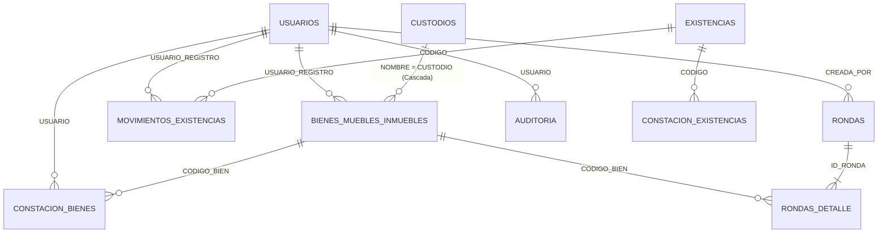

# DICCIONARIO DE DATOS Y ESTRUCTURA DE GOOGLE SHEETS
**Versión 2.7.0 | Base de Datos Relacional en Google Sheets**

Libro de Cálculo Principal:
```
SISTEMA_CONTROL_BIENES_EXISTENCIAS
```

A continuación se detalla la estructura canónica de las **10 hojas de cálculo** creadas y mantenidas automáticamente mediante el módulo `SetupDB.gs` (función `inicializarBaseDatos`).

---

## 1. Hoja: `USUARIOS`
Control de acceso, credenciales institucionales y roles del sistema.  
*Color de pestaña oficial:* `#1E3A8A` (Azul Profundo).  
*Formato de celda:* Columna D configurada como Texto Plano (`@`).

| Columna | Campo | Tipo de Dato | Ejemplo | Restricciones / Reglas de Validación |
| :---: | :--- | :--- | :--- | :--- |
| **A** | `ID_USUARIO` | Texto | `USR-0001` | Identificador único autogenerado con prefijo `USR-` y 4 dígitos. |
| **B** | `NOMBRE` | Texto | `Administrador General` | Nombre y apellido completo del funcionario. |
| **C** | `EMAIL` | Texto | `admin@institucion.gob.ec` | Correo electrónico único en minúsculas. Actúa como clave de autenticación. |
| **D** | `PASSWORD` | Texto | `s1$9a3b2c1d4e5f6789$5f4d...` | Hash criptográfico `SHA-256` con sal aleatoria única de 16 caracteres hexadecimales. |
| **E** | `ROL` | Lista | `ADMINISTRADOR` | Valores permitidos: `ADMINISTRADOR`, `INVENTARIADOR`, `CONSULTA`. |
| **F** | `ESTADO` | Lista | `ACTIVO` | Valores permitidos: `ACTIVO`, `INACTIVO`. |
| **G** | `FECHA_CREACION` | Fecha/Hora | `2026-09-30 08:30:00` | Marca de tiempo de registro en formato `yyyy-MM-dd HH:mm:ss`. |
| **H** | `ULTIMO_ACCESO` | Fecha/Hora | `2026-10-19 10:15:22` | Actualizado de manera automática en cada inicio de sesión exitoso. |

---

## 2. Hoja: `BIENES_MUEBLES_INMUEBLES`
Control patrimonial de Activos Fijos (BLD) y Bienes de Control Administrativo (BCA).  
*Color de pestaña oficial:* `#065F46` (Verde Esmeralda).  
*Formato de celda:* Columnas A, D y U configuradas como Texto Plano (`@`) para preservar ceros y caracteres exactos.

| Columna | Campo | Tipo de Dato | Ejemplo | Descripción / Regla de Validación |
| :---: | :--- | :--- | :--- | :--- |
| **A** | `CODIGO_BIEN` | Texto | `BLD-00001` | Código correlativo oficial o código de barra/etiqueta. Formato `BLD-00000` o `BCA-00000`. Unicidad obligatoria. |
| **B** | `TIPO_BIEN` | Lista | `BLD` | Clasificación patrimonial: `BLD` (Bien de Larga Duración) o `BCA` (Bien de Control Administrativo). |
| **C** | `BIEN` | Texto | `Computador Portátil Dell Latitude 5430` | Denominación principal descriptiva del bien. Campo obligatorio. |
| **D** | `SERIE` | Texto | `DL-99283-X` | Número de serie asignado por el fabricante o `S/N` si carece de serie. |
| **E** | `MODELO` | Texto | `Latitude 5430` | Modelo técnico del fabricante. |
| **F** | `MARCA` | Texto | `Dell` | Marca comercial registrada del activo. |
| **G** | `COLOR` | Texto | `Gris Titanio` | Color predominante del activo. |
| **H** | `MATERIAL` | Texto | `Aluminio / Polímero` | Material o composición principal del bien. |
| **I** | `DIMENSION` | Texto | `14 pulgadas` | Dimensiones físicas, medidas o capacidad. |
| **J** | `CONDICION` | Lista | `BUENO` | Estado operativo: `NUEVO`, `BUENO`, `REGULAR`, `MALO`, `DAÑADO`, `OBSOLETO`, `BAJA`. |
| **K** | `CUSTODIO` | Texto | `Ing. Roberto Andrade` | Nombre del servidor público legalmente responsable. Se actualiza en cascada si cambia en `CUSTODIOS`. |
| **L** | `DESCRIPCION_BIEN`| Texto | `Laptop Core i7 12th Gen, 16GB RAM...` | Ficha técnica pormenorizada y especificaciones detalladas. |
| **M** | `CUENTA_CONTABLE` | Texto | `141.01.07 Equipos de Computación` | Clasificador contable o presupuestario gubernamental. |
| **N** | `VIDA_UTIL` | Entero | `5` | Años estimados de vida útil contable (utilizado en el cálculo de depreciación en línea recta). |
| **O** | `VALOR_CONTABLE` | Decimal | `850.00` | Costo de adquisición o valor en libros expresado en dólares estadounidenses ($). |
| **P** | `OBSERVACION` | Texto | `Entregado con cargador y maletín original` | Historial de mantenimiento, actas, novedades o motivos de baja. |
| **Q** | `UBICACION` | Texto | `Edificio Central - Piso 3` | Ubicación geográfica, oficina, departamento o sede física. |
| **R** | `FECHA_REGISTRO` | Fecha/Hora | `2026-09-30 08:30:00` | Marca temporal de alta en el sistema institucional. |
| **S** | `USUARIO_REGISTRO`| Texto | `admin@institucion.gob.ec` | Correo del funcionario responsable de ingresar el activo. |
| **T** | `FOTO_ID` | Texto | `1AbCdEfGhIjKlMnOpQrStUvWxYz...` | Identificador único del archivo de imagen en Google Drive (carpeta `SISTEMA_BIENES_FOTOS`). |
| **U** | `FECHA_ADQUISICION`| Fecha | `2025-03-15` | Fecha de compra o factura en formato `AAAA-MM-DD`. Base prioritaria para el reporte de depreciación. |

---

## 3. Hoja: `CUSTODIOS`
Padrón institucional de servidores públicos responsables de la tenencia y custodia de bienes.  
*Color de pestaña oficial:* `#1E40AF` (Azul Cobalto).  
*Formato de celda:* Columna B configurada como Texto Plano (`@`) para conservar ceros iniciales en identificaciones.

| Columna | Campo | Tipo de Dato | Ejemplo | Restricciones / Reglas |
| :---: | :--- | :--- | :--- | :--- |
| **A** | `ID_CUSTODIO` | Texto | `CUST-001` | Identificador correlativo institucional con prefijo `CUST-` y 3 dígitos. |
| **B** | `CEDULA` | Texto | `0918293041` | Documento de identidad / Cédula / DNI. Debe ser único en el sistema. |
| **C** | `NOMBRE` | Texto | `Ing. Roberto Andrade` | Nombres y apellidos completos del custodio responsable. |
| **D** | `CARGO` | Texto | `Director de Tecnologías (TIC)` | Cargo oficial o función que ejerce en la institución. |
| **E** | `DEPARTAMENTO` | Texto | `Dirección de Tecnología` | Unidad administrativa, coordinación o gerencia. |
| **F** | `UBICACION` | Texto | `Edificio Central - Piso 3` | Oficina física o sede asignada por defecto. |
| **G** | `ESTADO` | Lista | `ACTIVO` | Estado del custodio: `ACTIVO` o `INACTIVO`. No puede eliminarse si tiene bienes asignados no dados de baja. |

---

## 4. Hoja: `EXISTENCIAS`
Catálogo de suministros consumibles, materiales de bodega y repuestos.  
*Color de pestaña oficial:* `#92400E` (Ámbar / Marrón Dorado).  
*Formato de celda:* Columnas A y C configuradas como Texto Plano (`@`).

| Columna | Campo | Tipo de Dato | Ejemplo | Descripción / Regla |
| :---: | :--- | :--- | :--- | :--- |
| **A** | `ID_EXISTENCIA` | Texto | `SUM-001` | Identificador correlativo con prefijo `SUM-` y 3 dígitos. |
| **B** | `CUENTA_CONTABLE` | Texto | `131.01.01 Suministros de Oficina` | Clasificador presupuestario de gasto o cuenta contable. |
| **C** | `CODIGO` | Texto | `EX-0001` | Código de barras o clave interna del producto. Unicidad obligatoria. |
| **D** | `DESCRIPCION` | Texto | `Papel Bond A4 75g (Resma 500 hojas)` | Denominación estandarizada del suministro o consumible. |
| **E** | `CANTIDAD` | Decimal | `450` | Saldo actual disponible en inventario físico de bodega. Actualizado atómicamente por Kardex. |
| **F** | `ESTADO` | Lista | `BUENO` | Calidad del lote: `BUENO`, `REGULAR`, `DETERIORADO`, `OBSOLETO`, `BAJA`. |
| **G** | `OBSERVACION` | Texto | `Stock para impresiones institucionales` | Ubicación dentro del almacén (percha, casillero) o detalles. |
| **H** | `STOCK_MINIMO` | Decimal | `15` | Umbral mínimo de reabastecimiento personalizable por ítem. Si no se especifica, por defecto es 15. |

---

## 5. Hoja: `MOVIMIENTOS_EXISTENCIAS` (KARDEX)
Libro de transacciones inmutables para el control de inventario de entradas y salidas.  
*Color de pestaña oficial:* `#7C2D12` (Terracota Oscuro).

| Columna | Campo | Tipo de Dato | Ejemplo | Regla de Negocio / Cálculo |
| :---: | :--- | :--- | :--- | :--- |
| **A** | `ID_MOVIMIENTO` | Texto | `MOV-00001` | Identificador correlativo inmutable con prefijo `MOV-` y 5 dígitos. |
| **B** | `FECHA` | Fecha/Hora | `2026-09-30 09:15:00` | Marca de tiempo exacta de ejecución del movimiento. |
| **C** | `TIPO_MOVIMIENTO` | Lista | `INGRESO POR COMPRA` | `INGRESO POR COMPRA`, `DEVOLUCIÓN`, `ENTREGA`, `CONSUMO`, `AJUSTE`, `BAJA`. |
| **D** | `CODIGO` | Texto | `EX-0001` | Código del ítem de existencias afectado. |
| **E** | `DESCRIPCION` | Texto | `Papel Bond A4 75g (Resma 500 hojas)` | Denominación del producto al momento del movimiento. |
| **F** | `CUENTA_CONTABLE` | Texto | `131.01.01 Suministros de Oficina` | Cuenta contable asociada. |
| **G** | `INGRESO` | Decimal | `500` | Cantidad recibida (mayor a 0 para entradas o ajustes positivos). |
| **H** | `SALIDA` | Decimal | `0` | Cantidad despachada (mayor a 0 para entregas, consumos o ajustes negativos). |
| **I** | `SALDO` | Decimal | `500` | `Saldo Resultante = Saldo Previo + Ingreso - Salida`. |
| **J** | `RESPONSABLE` | Texto | `Proveedor Papelera Nacional` | Entidad o funcionario solicitante, departamento o proveedor. |
| **K** | `OBSERVACION` | Texto | `Factura Nro. 001-020-004928` | Justificación, número de acta o requerimiento de respaldo. |
| **L** | `USUARIO_REGISTRO` | Texto | `admin@institucion.gob.ec` | Correo del funcionario responsable que registró la transacción. |

---

## 6. Hoja: `CONSTACION_BIENES`
Bitácora de auditorías físicas individuales realizadas sobre bienes muebles e inmuebles.  
*Color de pestaña oficial:* `#4C1D95` (Púrpura Profundo).

| Columna | Campo | Tipo de Dato | Ejemplo | Descripción |
| :---: | :--- | :--- | :--- | :--- |
| **A** | `ID_CONSTATACION` | Texto | `CB-20261019-101520-482` | Identificador único compuesto por fecha, hora y número aleatorio. |
| **B** | `FECHA` | Fecha/Hora | `2026-10-19 10:15:20` | Momento exacto del escaneo en terreno. |
| **C** | `CODIGO_BIEN` | Texto | `BLD-00001` | Código escaneado con la cámara o ingresado manualmente. |
| **D** | `BIEN` | Texto | `Computador Portátil Dell Latitude 5430` | Denominación del bien inspeccionado. |
| **E** | `CUSTODIO` | Texto | `Ing. Roberto Andrade` | Custodio registrado al momento de la inspección. |
| **F** | `UBICACION` | Texto | `Edificio Central - Piso 3` | Ubicación registrada en base de datos. |
| **G** | `CONDICION_SISTEMA`| Texto | `BUENO` | Condición que tenía el bien en el sistema antes del escaneo. |
| **H** | `CONDICION_FISICA` | Texto | `REGULAR` | Condición física real constatada por el inspector en el sitio. |
| **I** | `NOVEDAD` | Texto | `Carcasa con desgaste visible; cargador operativo` | Observaciones, hallazgos técnicos o novedades levantadas. |
| **J** | `USUARIO` | Texto | `inventario@institucion.gob.ec` | Correo del funcionario que efectuó la constatación en campo. |

---

## 7. Hoja: `CONSTACION_EXISTENCIAS`
Bitácora de conteos físicos y conciliación de suministros de bodega.  
*Color de pestaña oficial:* `#831843` (Rosa Oscuro / Borgoña).

| Columna | Campo | Tipo de Dato | Ejemplo | Regla de Cálculo |
| :---: | :--- | :--- | :--- | :--- |
| **A** | `ID_CONSTATACION` | Texto | `CE-20261019-112000` | Identificador único del conteo físico. |
| **B** | `FECHA` | Fecha/Hora | `2026-10-19 11:20:00` | Momento del conteo en almacén. |
| **C** | `CODIGO` | Texto | `EX-0001` | Código del suministro contado. |
| **D** | `DESCRIPCION` | Texto | `Papel Bond A4 75g (Resma 500 hojas)` | Nombre del producto verificado. |
| **E** | `STOCK_SISTEMA` | Decimal | `450` | Saldo teórico registrado en el sistema. |
| **F** | `STOCK_FISICO` | Decimal | `448` | Cantidad física real contada en los estantes. |
| **G** | `DIFERENCIA` | Decimal | `-2` | `Diferencia = Stock Físico - Stock Sistema`. |
| **H** | `ESTADO` | Texto | `BUENO` | Condición cualitativa del lote inspeccionado. |
| **I** | `OBSERVACION` | Texto | `Merma detectada por humedad en estantería` | Justificación técnica del faltante o sobrante. |
| **J** | `USUARIO` | Texto | `inventario@institucion.gob.ec` | Correo del operador responsable del conteo. |

---

## 8. Hoja: `RONDAS`
Registro consolidado de rondas planificadas de constatación física por custodio o ubicación.  
*Color de pestaña oficial:* `#4C1D95` (Púrpura Profundo).

| Columna | Campo | Tipo de Dato | Ejemplo | Descripción / Regla |
| :---: | :--- | :--- | :--- | :--- |
| **A** | `ID_RONDA` | Texto | `RON-0001` | Identificador correlativo de ronda con prefijo `RON-` y 4 dígitos. |
| **B** | `FECHA_INICIO` | Fecha/Hora | `2026-10-19 09:00:00` | Fecha y hora de creación de la ronda. |
| **C** | `TIPO_FILTRO` | Lista | `CUSTODIO` | Criterio de agrupación de la ronda: `CUSTODIO` o `UBICACION`. |
| **D** | `VALOR_FILTRO` | Texto | `Ing. Roberto Andrade` | Nombre del custodio o ubicación geográfica objetivo. |
| **E** | `ESTADO` | Lista | `ABIERTA` | Estado operativo de la ronda: `ABIERTA` o `CERRADA`. |
| **F** | `TOTAL` | Entero | `12` | Total de activos patrimoniales activos incluidos en la ronda. |
| **G** | `VERIFICADOS` | Entero | `11` | Cantidad de bienes constatados físicamente conformes o con novedad. |
| **H** | `FALTANTES` | Entero | `1` | Cantidad de bienes no localizados en la inspección. |
| **I** | `CON_DIFERENCIA`| Entero | `2` | Bienes verificados cuya condición física difiere de la del sistema. |
| **J** | `CREADA_POR` | Texto | `inventario@institucion.gob.ec` | Correo del usuario que abrió la ronda de inventario. |
| **K** | `FECHA_CIERRE` | Fecha/Hora | `2026-10-19 12:30:00` | Momento en que la ronda fue finalizada oficialmente. |
| **L** | `OBSERVACION` | Texto | `Constatación anual Dirección de Tecnología` | Conclusiones o notas generales del cierre de la ronda. |

---

## 9. Hoja: `RONDAS_DETALLE`
Líneas de detalle de cada bien que conforma una ronda de constatación física.  
*Color de pestaña oficial:* `#5B21B6` (Violeta Intenso).

| Columna | Campo | Tipo de Dato | Ejemplo | Descripción |
| :---: | :--- | :--- | :--- | :--- |
| **A** | `ID_RONDA` | Texto | `RON-0001` | Clave foránea que referencia a la hoja `RONDAS`. |
| **B** | `CODIGO_BIEN` | Texto | `BLD-00001` | Código patrimonial del bien asignado a la ronda. |
| **C** | `BIEN` | Texto | `Computador Portátil Dell Latitude 5430` | Denominación del activo. |
| **D** | `CUSTODIO` | Texto | `Ing. Roberto Andrade` | Servidor público legalmente responsable. |
| **E** | `UBICACION` | Texto | `Edificio Central - Piso 3` | Ubicación registrada en base de datos. |
| **F** | `CONDICION_SISTEMA`| Texto | `BUENO` | Condición que tenía el bien al momento de abrir la ronda. |
| **G** | `ESTADO_ITEM` | Lista | `VERIFICADO` | Estado del ítem en la ronda: `PENDIENTE`, `VERIFICADO`, `FALTANTE`. |
| **H** | `CONDICION_FISICA` | Texto | `REGULAR` | Condición física detectada en campo al momento de verificar. |
| **I** | `NOVEDAD` | Texto | `Carcasa rayada; cargador original operativo` | Novedad técnica o hallazgo documentado en la verificación. |
| **J** | `FECHA_VERIFICACION`| Fecha/Hora| `2026-10-19 10:14:00` | Momento en que el operador marcó el activo en la aplicación. |
| **K** | `USUARIO` | Texto | `inventario@institucion.gob.ec` | Correo del operador que inspeccionó el activo. |

---

## 10. Hoja: `AUDITORIA`
Bitácora inmutable de trazabilidad y registro continuo de mutaciones institucionales.  
*Color de pestaña oficial:* `#1F2937` (Gris Pizarra Oscuro).

| Columna | Campo | Tipo de Dato | Ejemplo | Descripción |
| :---: | :--- | :--- | :--- | :--- |
| **A** | `FECHA` | Fecha/Hora | `2026-10-19 11:45:10` | Marca de tiempo exacta de la mutación o evento de seguridad. |
| **B** | `USUARIO` | Texto | `admin@institucion.gob.ec` | Correo del usuario que ejecutó la acción o `SISTEMA`. |
| **C** | `ACCION` | Texto | `CREAR`, `MODIFICAR`, `BAJA`, `ELIMINAR`, `LOGIN`, `IMPORTACION_MASIVA`, `ALERTA` | Tipo formal de evento. |
| **D** | `MODULO` | Texto | `BIENES`, `EXISTENCIAS`, `CUSTODIOS`, `KARDEX`, `USUARIOS`, `RONDAS`, `CONFIGURACION`, `SEGURIDAD` | Módulo afectado. |
| **E** | `REGISTRO_AFECTADO`| Texto | `BLD-00003`, `EX-0001`, `RON-0001` | Identificador del registro sujeto a mutación. |
| **F** | `VALOR_ANTERIOR` | Texto/JSON | `{"custodio":"Ing. Roberto Andrade"}` | Estado o valores anteriores del objeto (máximo 500 caracteres). |
| **G** | `VALOR_NUEVO` | Texto/JSON | `{"custodio":"Lic. María Torres"}` | Nuevos valores ingresados o resumen del cambio (máximo 500 caracteres). |

---

## 11. Relaciones de Integridad y Claves Foráneas



1. **Cascada Custodio - Bienes:**
   Al actualizar el campo `NOMBRE` en la hoja `CUSTODIOS`, la función `actualizarNombreCustodioEnBienes` busca y reemplaza automáticamente todas las ocurrencias en la columna `CUSTODIO` de `BIENES_MUEBLES_INMUEBLES`.
2. **Restricción de Eliminación de Custodios:**
   No es posible eliminar un custodio si aún posee bienes asignados cuya condición sea distinta de `BAJA`.
3. **Integridad Atómica Kardex - Existencias:**
   Cada fila creada en `MOVIMIENTOS_EXISTENCIAS` actualiza obligatoriamente la celda `CANTIDAD` en `EXISTENCIAS` dentro de un bloque sincronizado por `LockService`.
4. **Relación Ronda - Detalle:**
   La hoja `RONDAS` mantiene los agregados consolidados (`TOTAL`, `VERIFICADOS`, `FALTANTES`, `CON_DIFERENCIA`) calculados directamente desde las filas hijas en `RONDAS_DETALLE`.
